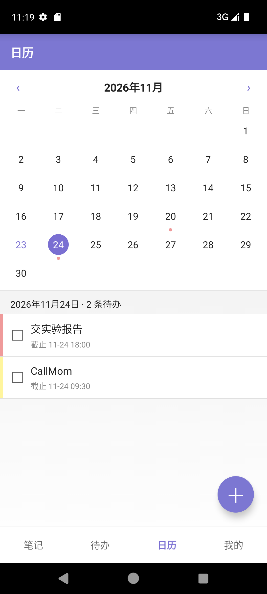
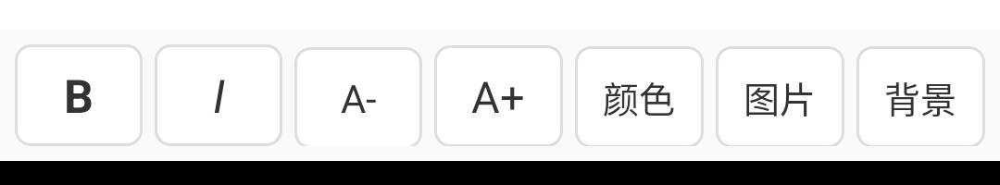
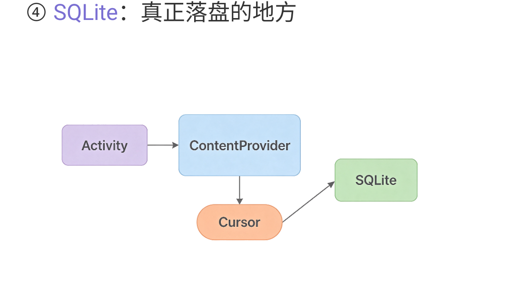
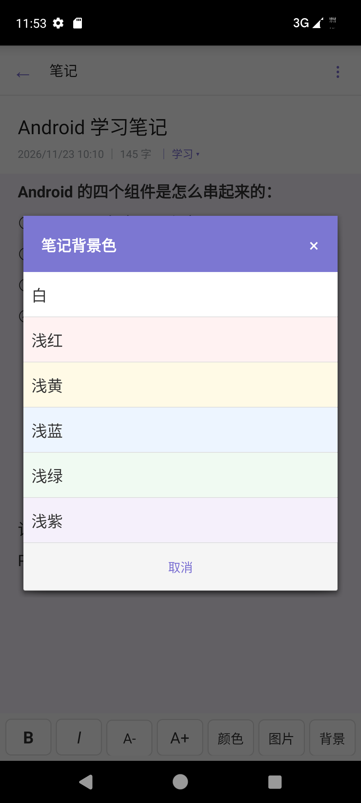
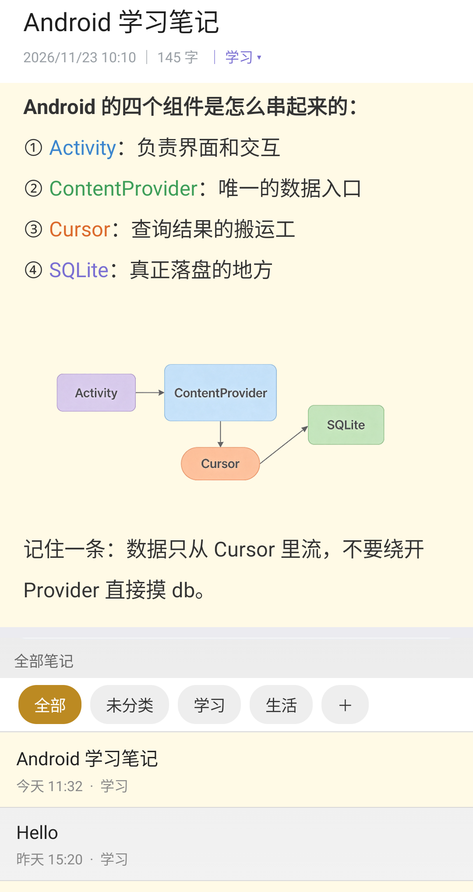
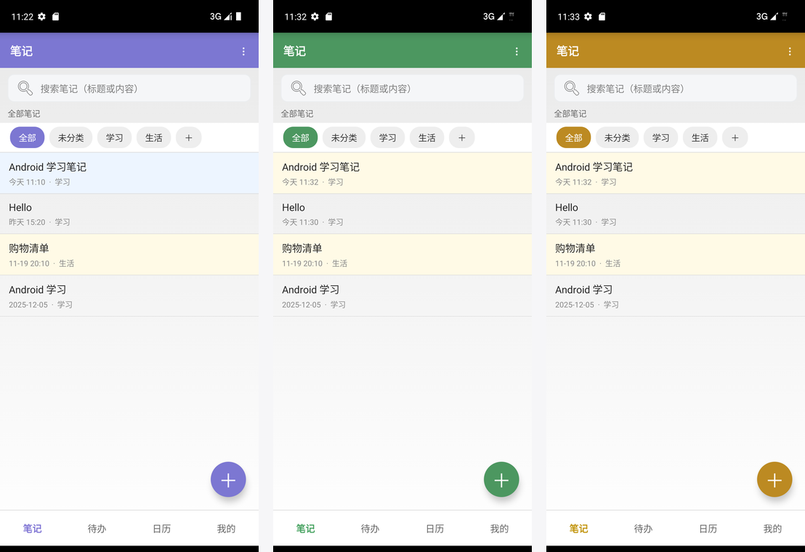
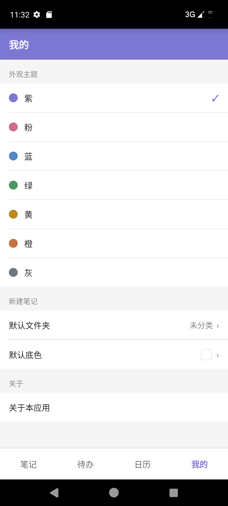
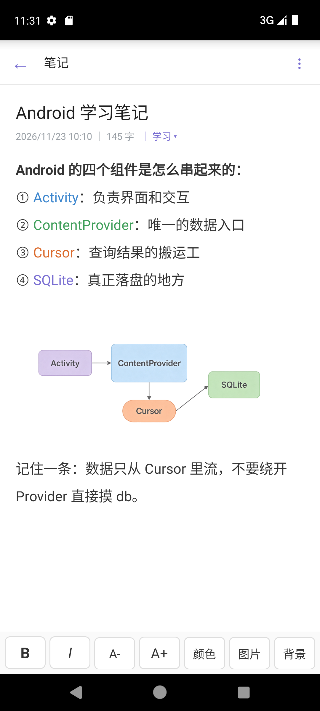

# NotePad 记事本 —— 移动软件开发期中实验

| 项目 | 内容                                                                            |
|---|-------------------------------------------------------------------------------|
| 项目名 | NotePad 记事本（基于官方NotePad示例扩展）                                                  |
| 被评阅人 | 张家颖　121052024134                                                              |
| 运行环境 | Android Studio 2025.1 / Gradle 9.8 / AGP 9.3 / JDK 21 / compileSdk 37 / minSdk 21 |
| 调试设备 | Pixel 7 模拟器（1080×2400，Android 15）                                             |

原有工程用的是最老的那份 NotePad 示例：笔记存在 `SQLite` 里，外面套一层 `ContentProvider`，界面是 `ListActivity` + 一个铅笔按钮。下面所有内容都是在这份代码上改出来的，原有的增删改查、剪贴板、Live Folder 都保留着可用。

---

## 一、功能

| 编号 | 功能 | 类型 | 一句话说明 |
|---|---|---|---|
| A | 列表时间戳 | 基本功能 | 每行标题下面显示例如"今天 08:55 · 学习"，最近改过的排在最前 |
| B | 搜索 | 基本功能 | 常驻搜索框，边打边筛，标题和正文都能命中 |
| C | 底部导航 + 待办 | 扩展 | 笔记 / 待办 / 日历 / 我的 四页，待办能勾完成、分优先级、截止到分钟 |
| D | 日历 | 扩展 | 自绘月历，有未完成待办的日期带色点，点某天看当天待办 |
| E | 文件夹分类 | 扩展 | 文件夹可建可嵌套，笔记归到某一层，顶部 chip 条切换 |
| F | 富文本 + 插图 | 扩展 | 选中文字可加粗/斜体/改字号/改颜色，正文里能插图片 |
| G | 笔记背景色 | 扩展 | 六色纸底色板，编辑页和列表行同步变色 |
| H | UI 美化 | 扩展 | 自绘顶栏、圆形加号、七套主题、设置页、字号统一 |
| I | 编辑页重做 | 扩展 | 去掉蓝横线，标题搬到正文上方大字，点标题改名 |

---

## 二、基本功能一：列表时间戳

### 2.1 要做成什么样

原版列表每行只有一个标题，看不出哪篇是刚写的、哪篇是一周前的。改造后一行两行字：上面标题 16sp，下面一行 12sp 灰字显示修改时间，而且时间必须"能直接看懂"，不能是 `2026-11-16 08:05:23` 这种长串。

> **【截图 01】笔记列表（标题 + 时间）**


### 2.2 怎么做的

1. `noteslist_item.xml` 从"一个 TextView"改成竖向两个：`@android:id/text1` 放标题，`text_time` 放时间。`text1` 这个 id 不能改名——`SimpleCursorAdapter` 默认就找它。
2. `NotesList` 的投影里多要一列 `modified`。数据库里本来就存着修改时间（Provider 的 `insert`/`update` 会自动写），只是原来没显示。
3. 用 `SimpleCursorAdapter.ViewBinder` 接管这一列：拿到毫秒值自己格式化，而不是让适配器直接 `setText` 一个数字。
4. 格式化写了个 `shortTime(long)`，按"今天 / 昨天 / 今年 / 跨年"四档输出。

```java
private String shortTime(long timeMillis) {
    Calendar now = Calendar.getInstance();
    Calendar t = Calendar.getInstance();
    t.setTimeInMillis(timeMillis);

    boolean thisYear = now.get(Calendar.YEAR) == t.get(Calendar.YEAR);
    String hm = new SimpleDateFormat("HH:mm", Locale.getDefault()).format(new Date(timeMillis));

    if (thisYear && now.get(Calendar.DAY_OF_YEAR) == t.get(Calendar.DAY_OF_YEAR))
        return "今天 " + hm;
    if (thisYear && now.get(Calendar.DAY_OF_YEAR) - t.get(Calendar.DAY_OF_YEAR) == 1)
        return "昨天 " + hm;
    if (thisYear)
        return new SimpleDateFormat("MM-dd HH:mm", Locale.getDefault()).format(new Date(timeMillis));
    return new SimpleDateFormat("yyyy-MM-dd", Locale.getDefault()).format(new Date(timeMillis));
}
```

这个函数不是适配器直接调，而是包在 `SimpleCursorAdapter.ViewBinder` 里——拿到 cursor 里的毫秒值，自己算成字符串再塞给 `TextView`：

```java
@Override
public boolean setViewValue(View view, Cursor cursor, int columnIndex) {
    if (view.getId() == R.id.text_time) {
        long millis = cursor.getLong(columnIndex);
        String time = shortTime(millis);                 // 功能A：四档短时间

        int folderIdx = cursor.getColumnIndex(COLUMN_NAME_FOLDER);
        if (folderIdx >= 0) {                            // 功能E：非「未分类」再带上文件夹名
            long id = cursor.getLong(folderIdx);
            String name = folderNames.get(id);
            if (id != DEFAULT_FOLDER_ID && name != null) {
                time = time + "  ·  " + name;
            }
        }
        ((TextView) view).setText(time);
        return true;                                     // 这一列处理完了，别走默认 setText
    }
    return false;
}
```

### 2.3 跨年边界

判断"昨天"用的是 `DAY_OF_YEAR` 相减，所以前面必须先确认是同一年。否则 1 月 1 日会被算成"12 月 31 日的昨天"，显示"昨天 23:59"。

完整到秒的时间没有删掉，挪到了编辑页标题下面那行元信息（`2026/11/23 10:17 ｜ 128 字`），需要精确时间时去那儿看。

---

## 三、基本功能二：搜索

### 3.1 要做成什么样

列表页顶部放一个输入框，输入即筛，不用点按钮；清空立刻恢复全部；搜不到要有提示，不能只留一片白。

> **【截图 02】搜索 "Android" 的结果**


> **【截图 03】搜不到时的空态**


### 3.2 怎么做的

1. `activity_notes_list.xml` 加一个常驻 `EditText`（`search_input`），44dp 高，背景换成自建的 `search_bg.xml`（浅灰圆角 10dp + 1dp 边），去掉系统默认那条黑色下划线。
2. `TextWatcher` 的 `onTextChanged` 里直接调 `refreshList()`。没做防抖、也没设"搜索"按钮：本地 SQLite 几百条的量级，每次都查完刷新反而更跟手。
3. 查询条件拼进 `selection`，并且要**和文件夹条件叠加**——既要有"当前在哪个文件夹（含子孙）"的过滤，也要有搜索词的过滤，两者是 `AND`。

```java
selection.append("(")
        .append(COLUMN_NAME_TITLE).append(" LIKE ? OR ")
        .append("COALESCE(").append(COLUMN_NAME_PLAIN_TEXT).append(",").append(COLUMN_NAME_NOTE)
        .append(") LIKE ?")
        .append(")");
args.add("%" + keyword + "%");
args.add("%" + keyword + "%");
```

触发这次重查的是搜索框自己的 `TextWatcher`：

```java
searchInput.addTextChangedListener(new TextWatcher() {
    @Override
    public void onTextChanged(CharSequence s, int start, int before, int count) {
        keyword = s.toString().trim();
        refreshList();      // 重新拼 selection（文件夹条件 AND 关键词条件），再 requery
    }
});
```

### 3.3 两个细节

**为什么搜 `plain_text` 而不是直接搜 `note`**：加了富文本之后，`note` 列里存的是带格式的 JSON，直接 `LIKE` 会匹配到 `{"v":1,"spans"...` 这类结构串——搜一个 "v" 都能出来一堆结果。所以另存一列剥掉格式的纯文本，专门给搜索用；老笔记这一列是 NULL，用 `COALESCE` 退回 `note` 列，照样搜得到。

**空态**：`refreshList()` 末尾判一次结果条数，0 条时显示"没有找到含「xxx」的笔记"；文件夹本身是空的则显示"这里还没有笔记，点右下角「＋」写一篇"。注意 `onCreate` 里也要主动调一次 `refreshList()`——适配器自己那次查询管显示，管不到这行字。

---

## 四、扩展功能一：底部导航 + 待办

### 4.1 为什么做

原来的界面只有"笔记"一个平面列表。笔记是"存下来以后看"，还缺一个"提醒我什么时候做"——记事本类产品的通用做法就是加一层待办。导航用底部四个 tab 而不是顶部 tab 或抽屉，因为这是高频切换的入口，底部单手能够到。

> **【截图 04】待办页（分组 + 优先级色条 + 勾选变灰）**


### 4.2 导航

- `bottom_nav.xml`：一条 147dp 高的横条，四个等宽 `TextView`（笔记 / 待办 / 日历 / 我的）。
- `NavHelper` 把四个点击收进一个类，每个页面 `onCreate` 和 `onResume` 都 `bind` 一次，选中态用主题色，未选中用 `#666666`。
- 跳转用 `FLAG_ACTIVITY_REORDER_TO_FRONT`：从"待办"点到"笔记"时，如果笔记页实例已经在栈里，就不新建、直接提到前面，避免来回点几下攒出一堆 Activity 实例。

```java
Intent it = new Intent(context, target);
it.addFlags(Intent.FLAG_ACTIVITY_REORDER_TO_FRONT);   // 已在栈里就提到前台，不产生新实例
context.startActivity(it);
```

> **【截图 05】底栏四个 tab（含"我的"）**


### 4.3 待办的数据和界面

待办单独一个库 `notepad_todo.db`，表 `todos`：

```sql
CREATE TABLE todos (
  _id INTEGER PRIMARY KEY AUTOINCREMENT,
  title TEXT NOT NULL,
  done INTEGER NOT NULL DEFAULT 0,
  due_time INTEGER NOT NULL DEFAULT 0,      -- 0 = 没设截止时间
  priority INTEGER NOT NULL DEFAULT 2,      -- 1 紧急 / 2 一般 / 3 不急
  created INTEGER NOT NULL
);
```

**为什么单开一个库而不是塞进 `notes`**：待办和笔记是两种东西，字段几乎不重叠（待办没有正文、背景色、文件夹）。硬塞进同一张表会让每个字段都变得 `NULL` 遍地，而且老师那份 `NotePadProvider` 是评分基准，不该为了新功能去动它的 URI 和匹配器。单开一个 `SQLiteOpenHelper` 最省事，也不影响原有功能。

### 4.4 新建 / 编辑对话框

内容 + 优先级 + 截止时间三块，新建和编辑共用一套布局 `dialog_add_todo.xml`：

- 优先级是三个并排的按钮（紧急 / 一般 / 不急），选中的打勾并满不透明，其余 55% 透明。
- 截止时间点一下先弹系统 `DatePickerDialog`，选完日期紧接着弹 `TimePickerDialog` 选几点几分（24 小时制）。**两个对话框之间延迟了 250ms**，不然日期框的退出动画还没结束就弹新窗口，容易报窗口重叠。

```java
new Handler(Looper.getMainLooper()).postDelayed(new Runnable() {
    @Override
    public void run() {
        new TimePickerDialog(activity, listener, hour, minute, true).show();   // true = 24 小时制
    }
}, 250);   // 等日期框的退场动画走完再弹下一个
```

> **【截图 06】新建待办对话框**


### 4.5 排序与分组

排序完全交给 SQL，不在 Java 里排：

```sql
ORDER BY done ASC,
         CASE WHEN done = 0 AND due_time > 0 AND due_time < <now> THEN 1 ELSE 0 END ASC,
         priority ASC, due_time ASC, created DESC
```

读法是：未完成在前 → 其中已过期的提到最前 → 再按优先级（1 最急）→ 再按截止时间 → 最后新的在前。

分组标题不是靠 `ListView` 的 section，而是在 `TodoAdapter` 里往数据流中插"假行"：`Row` 要么是分组头、要么是一条待办，`getViewTypeCount()` 返回 2，`getItemViewType()` 区分。这样列表只有一个，滚动连续，不用拼接多个 ListView。

```java
private static final int TYPE_HEADER = 0;
private static final int TYPE_TODO = 1;

@Override
public int getViewTypeCount() {
    return 2;                                            // 告诉 ListView 要缓存两种行
}

@Override
public int getItemViewType(int position) {
    return rows.get(position).header ? TYPE_HEADER : TYPE_TODO;
}
```

> **【截图 07】三个分组头（待完成 / 已过期 / 已完成）**


### 4.6 行内视觉

- 左侧 4dp 宽的**优先级色条**：紧急浅红 `#EF9A9A`、一般浅黄 `#FFF59D`、不急浅蓝 `#90CAF9`；完成的一律变灰 `#E0E0E0`。
- 勾选后标题变灰并加删除线（`Paint.STRIKE_THRU_TEXT_FLAG`）。
- 截止时间那行：过期未完成的写成"已过期 · 截止 11-20 09:30"并变红；正常的是"截止 11-23 09:30"灰字；没设的是"无截止时间"。
- 复选框复用要小心：**每次 `getView` 先 `setOnCheckedChangeListener(null)` 再 `setChecked()`，最后才挂监听**，否则滑动列表时被复用的行会把上一行的勾选状态"传染"过去。

```java
cb.setOnCheckedChangeListener(null);      // 先拆：拆掉监听时 setChecked 不会回调
cb.setChecked(todo.done);                 // 再按这条数据摆正
cb.setOnCheckedChangeListener(listener);  // 最后才装回去
```

### 4.7 删除入口

原来只有长按删除，实测下来问题是"根本不知道能长按"。所以编辑框底部也放了一个"删除"——点了再弹一次确认，文案里明说"删了就没了，不能撤销"。长按删除保留，作为第二个入口。

> **【截图 08】编辑待办对话框底部的「删除」**


---

## 五、扩展功能二：日历

### 5.1 为什么不用系统的 CalendarView

第一版就是系统 `CalendarView`，实机上一眼看出三个问题：

1. 只能在格子上显示日期，**没法表示"这天有几条没做完的待办"**；
2. 它自己有一套选中态，但和下面的待办列表联动不了；
3. 下面那块"当天待办"只能把几条待办拼成一段字符串塞进 TextView，勾不了完成。

与其在系统控件外面贴一层皮，不如自己画。代价是要算日期排版，收益是所有表现都可控。

> **【截图 09】日历页（自绘月历 + 日期色点 + 当天待办）**


### 5.2 自绘 `MonthGrid`

一个自定义 `View`，按 6 行 × 7 列画格子，固定 6 行（不是"这个月几周就画几周"），这样翻月时控件高度不会跳。

- 格高 44dp，日号 32dp 字号，色点直径 5dp，星期标签是 `一二三四五六日`。
- 首格位置：`offset = (DAY_OF_WEEK + 5) % 7`。`Calendar.DAY_OF_WEEK` 是周日=1、周一=2……减去 5 再模 7，正好把周一挪到第 0 列。
- 当月天数用 `getActualMaximum(Calendar.DAY_OF_MONTH)` 取，不能硬写 30/31——2 月和闰年会错。

每次翻月、改选中日、色点变化，都只重跑一遍 `refresh()`，格子控件是建好复用的：

```java
int offset = (first.get(Calendar.DAY_OF_WEEK) + 5) % 7;            // 周一挪到第 0 列
int daysInMonth = first.getActualMaximum(Calendar.DAY_OF_MONTH);   // 大小月/闰年交给系统

int day = 1;
for (int r = 0; r < ROWS; r++) {
    for (int col = 0; col < COLS; col++) {
        int index = r * COLS + col;
        if (index < offset || day > daysInMonth) {                 // 这个格子不属于本月
            num.setText("");
            num.setBackground(null);
            dot.setVisibility(INVISIBLE);
            continue;
        }
        num.setText(String.valueOf(day));
        if (day == selectedDay) {                                  // 选中：实心圆 + 白字
            num.setBackground(circle(accentColor));
            num.setTextColor(Color.WHITE);
        }
        Integer mark = markColors.get(day);                        // 有未完成待办：下面打一点
        dot.setVisibility(mark != null ? VISIBLE : INVISIBLE);
        day++;
    }
}
```

### 5.3 联动

- 点某天 → `onDaySelected` → `refreshDay()` → 用 `due_time` 落在该日 `00:00:00 ~ 23:59:59` 区间查出当天待办，塞给 `TodoAdapter`，并 `setGrouped(false)`（同一天的列表不需要"待完成/已过期"这种分组头）。
- 勾选当天某条 → 立刻写库 → 重刷当天列表 **和** 月历色点。
- 色点规则：这天只要还有未完成的待办就打一个点，颜色取**当天最急的那条**的优先级色——这样同一天有好几条时不会挤成一堆点。
- 右下角加号："在这天加待办"，截止时间默认是选中那天的 `23:59:59`。
- 月历的选中圆、今天数字、左右箭头都用主题色（`setAccentColor`），换主题时跟着变。

> **【截图 10】点某天 → 下方列表跟着变**



---

## 六、扩展功能三：文件夹分类

### 6.1 为什么做

原版所有笔记平铺在一个列表里，十几篇就开始乱。文件夹是最贴近"记事本"这个场景的整理方式，顺带还能把嵌套结构、导航条、长按菜单、递归查询几件事一次讲清。

> **【截图 11】顶层文件夹条（全部 | 未分类 | 学习 | 生活 | ＋）**


### 6.2 数据结构

不动 `note_pad.db` 的主体，只给 `notes` 加一列 `folder_id`；文件夹自己一个库 `notepad_folder.db`：

```sql
CREATE TABLE folders (
  _id        INTEGER PRIMARY KEY AUTOINCREMENT,
  name       TEXT    NOT NULL,
  parent_id  INTEGER NOT NULL DEFAULT 0,   -- 0 = 顶层
  created    INTEGER NOT NULL
);
```

- 建库时就插好一条 `_id = 1, name = '未分类'`，`notes.folder_id` 的默认值也是 1。**任何笔记都有归属，不会出现"孤儿笔记"**，列表也不会有"没有文件夹"的空档。
- 删除文件夹不删笔记：先把该文件夹（连同子孙）里的笔记 `folder_id` 改成 1，再删文件夹记录。对用户来说就是"取消分类"，笔记一条不少。

### 6.3 导航条

"横向 chip 条 + 面包屑"两层：

- 顶层显示 `全部 | 未分类 | 学习 | 生活 | ＋`，"全部"是选中态（当前不限定文件夹）。
- 点进"学习"以后变成 `← 上一级 | 它的子文件夹… | ＋`，上面一行面包屑 `全部笔记 › 学习`，点面包屑回到"全部"。
- chip 长按弹菜单：改名 / 删除。改名用带输入框的对话框；删除会提示"里面的 N 篇笔记会移到未分类"。
- 「未分类」不允许改名和删除——它是兜底，删了就没人接盘。

> **【截图 12】进入"学习"后的面包屑与子文件夹**


> **【截图 13】长按 chip 的改名 / 删除菜单**


### 6.4 两处递归

- **看笔记**：点进某个文件夹时，列表要显示它和它所有子孙里的笔记，所以先递归收集 id 列表再拼 `IN (...)`：

```java
public List<Long> selfAndDescendants(long id) {
    List<Long> out = new ArrayList<>();
    collectFilter(id, out);
    return out;
}

private void collectFilter(long id, List<Long> out) {
    out.add(id);
    for (Folder child : listByParent(id)) {   // 逐层往下查，嵌套多深都能收全
        collectFilter(child.id, out);
    }
}
```

拿到 id 列表之后拼成占位符条件，具体值走 `selectionArgs`：

```java
List<Long> ids = folderDb.selfAndDescendants(currentFolderId);
StringBuilder where = new StringBuilder("folder_id IN (");
for (int i = 0; i < ids.size(); i++) {
    if (i > 0) where.append(",");
    where.append("?");
}
where.append(")");
```

- **删文件夹**：同样递归收集子孙，但**必须跳过 id = 1 的默认文件夹**，否则"未分类"会被连带删掉。

---

## 七、扩展功能四：富文本 + 插图

### 7.1 存什么：没有用 HTML

`EditText` 天生支持 `Spannable`——加粗、斜体、字号、颜色本质都是"一段区间 + 一组属性"。问题在于 `Spannable` 不能直接进数据库，得序列化。

试过存 HTML（`Html.toHtml()`），放弃了，原因三条：

1. `toHtml` 只认有限的几种标签，字号和自定义颜色会丢或变形；
2. 回读 `Html.fromHtml()` 得到的 `Spanned` 和原来不完全一致，改一个字就可能整段样式跑偏；
3. 富文本里还要插图片，HTML 里塞 `` 得自己维护路径，更乱。

最后自己定了一份很轻的区间表，JSON 存进 `note` 列：

```json
{"v":1,
 "spans":[{"s":0,"e":4,"b":1,"i":0,"size":0,"color":0},
          {"s":5,"e":9,"img":"img_1732412345.jpg"}],
 "text":"第一段正文…"}
```

- `s`/`e` 是字符下标，`k` 是类型（`b` 加粗 / `i` 斜体 / `bi` 又粗又斜 / `c` 颜色 / `z` 字号 / `img` 图片），`v` 是取值（颜色 int、字号 sp、图片文件名）。
- 一个区间只带一种属性，同一段字又有颜色又加粗就是两条区间，回读时叠在同一个 `Spannable` 上。

写进库的那一步在 `NoteFormat.serialize()`：遍历编辑器里所有 span，只认上面五种，别的（光标、拼写检查、输入法候选）全部丢掉。

```java
public static String serialize(CharSequence text) {
    SpannableStringBuilder sb = new SpannableStringBuilder(text);
    JSONArray spans = new JSONArray();

    for (Object sp : sb.getSpans(0, sb.length(), Object.class)) {
        int s = sb.getSpanStart(sp), e = sb.getSpanEnd(sp);
        if (s < 0 || e <= s) continue;                 // 空区间、脏 span 直接跳过

        JSONObject item = new JSONObject();
        if (sp instanceof StyleSpan) {
            int style = ((StyleSpan) sp).getStyle();
            if (style == Typeface.BOLD) item.put("k", "b");
            else if (style == Typeface.ITALIC) item.put("k", "i");
            else if (style == (Typeface.BOLD | Typeface.ITALIC)) item.put("k", "bi");
            else continue;
        } else if (sp instanceof ForegroundColorSpan) {
            item.put("k", "c").put("v", ((ForegroundColorSpan) sp).getForegroundColor());
        } else if (sp instanceof AbsoluteSizeSpan) {
            item.put("k", "z").put("v", ((AbsoluteSizeSpan) sp).getSize());
        } else if (sp instanceof ImageSpan) {
            String src = ((ImageSpan) sp).getSource();  // 只存文件名，不存路径
            if (src == null || src.length() == 0) continue;
            item.put("k", "img").put("v", new File(src).getName());
        } else {
            continue;
        }
        item.put("s", s).put("e", e);
        spans.put(item);
    }
    return new JSONObject().put("v", 1).put("t", sb.toString()).put("spans", spans).toString();
}
```

### 7.2 编辑时的两个硬问题

**区间会跟着文字移动**。`EditText` 里挂的 span 用的是 `SPAN_EXCLUSIVE_EXCLUSIVE`，在中间插字删字时由框架自己把区间边界挪开，不需要手写长度修正。真正的麻烦在**第二次改格式时的重叠**：一段字先上了红色，再从中间选一半加粗，旧的红色区间跨过新的边界，整段替换就会把另一半颜色也冲掉。

做法是先"切"再"加"——把跨过边界的旧区间一分为二，只动中间要改的那段：

```java
// 上色前调用：把跨过 [start, end] 边界的旧颜色区间拆成左右两段
private void cutSpans(Spannable sb, int start, int end) {
    for (ForegroundColorSpan sp : sb.getSpans(start, end, ForegroundColorSpan.class)) {
        int s = sb.getSpanStart(sp), e = sb.getSpanEnd(sp);
        int color = sp.getForegroundColor();
        sb.removeSpan(sp);
        if (s < start) sb.setSpan(new ForegroundColorSpan(color),
                s, start, Spanned.SPAN_EXCLUSIVE_EXCLUSIVE);   // 左边保留
        if (e > end)   sb.setSpan(new ForegroundColorSpan(color),
                end, e, Spanned.SPAN_EXCLUSIVE_EXCLUSIVE);     // 右边保留
    }
}
```

加粗、斜体、字号走的是同一套逻辑，只是循环的 span 类型不同。

**只对选中的文字生效**。工具栏按钮不是"开关全局样式"，而是取 `getSelectionStart/End`：有选区就作用于选区，没选区就作用于"接下来要输入的字"。

> **【截图 14】选中文字后点加粗、改色**


> **【截图 15】底部格式工具栏（7 个按钮）**



### 7.3 插图

- 走系统图片选择器（`ACTION_GET_CONTENT` + `CATEGORY_OPENABLE`），**不申请存储权限**——系统会把选中那张的读取权临时授给我们，用完收回。
- 不直接引用原图：相册里那张随时会被删、被改名，绝对路径两天就成死链。做法是**复制一份压缩版**进应用私有目录 `files/notes_img/`，数据库只记文件名。
- 压缩分两步：先 `inJustDecodeBounds` 只读尺寸（不解码像素，省内存），按 2 的幂设 `inSampleSize` 粗缩；再精确缩到最长边 1080，JPEG 质量 85。一张 4000×3000 的照片压完通常几十 KB。
- 编辑器里显示时再按最长边 900 缩一次，避免撑出横向滚动。

压缩这段代码在 `ImageStore.save()`：

```java
// 第一遍只读尺寸，不把像素读进内存
BitmapFactory.Options o = new BitmapFactory.Options();
o.inJustDecodeBounds = true;
BitmapFactory.decodeStream(in, null, o);        // 这时 o.outWidth/outHeight 有值，bitmap 是 null

// 第二遍按 2 的幂降采样粗缩，再精确缩到最长边 1080
o.inJustDecodeBounds = false;
o.inSampleSize = sampleSizeFor(o.outWidth, o.outHeight, SAVE_MAX_EDGE);
Bitmap bm = BitmapFactory.decodeStream(in2, null, o);
Bitmap scaled = scaleToMaxEdge(bm, SAVE_MAX_EDGE);
scaled.compress(Bitmap.CompressFormat.JPEG, 85, fos);
```

> **【截图 16】正文里插入的图片**



### 7.4 顺手补的一列

`notes` 表加了 `image_path`（多个文件名用 `|` 分隔）。它不是给显示用的（正文里已经有图片信息），纯粹是**冗余索引**：删笔记时能直接拿到要清的文件名，不用解析 JSON。

> 这一列的由来是一个实际漏洞：编辑页删笔记本来就会清图片，但列表页长按删除走的是另一条代码路径，一开始漏了。`files/notes_img/` 里的图就永久留在那儿，越用越占空间。补上之后两条路径都会清。

---

## 八、扩展功能五：笔记背景色

### 8.1 为什么做

纯白底色看久了刺眼；而饱和的彩底又会压住黑字。所以做的是"带一点点色的纸"——六档，白 / 浅红 / 浅黄 / 浅蓝 / 浅绿 / 浅紫，本质都是 `#FFFFFF` 往某个色相偏一点点。

> **【截图 17】编辑页的六色色板弹窗**



> **【截图 18】浅黄底色 + 列表行同步**



### 8.2 怎么做的

- 色值集中写在 `NotePad.Notes.BG_COLORS` 与 `BG_COLOR_NAMES` 两个数组里，顺序一一对应，弹窗就是按数组动态生成六行"色块 + 名字"。
- 选中的颜色写进 `bg_color` 列（`#RRGGBB` 字符串）。
- 编辑页铺底：`mText.setBackgroundColor(色值)`，工具栏那条不跟着变，保证按钮始终在浅色底上。
- 列表行同步：`setViewValue` 里判断这一列是 `bg_color` 时，直接给整行 `setBackgroundColor`；如果是纯白就不设，让默认的白色露出来。

```java
// 列表行：这一列的值是 #RRGGBB，铺成整行底色；纯白不设，露出默认背景
if (view.getId() == R.id.row_bg) {
    String bg = cursor.getString(columnIndex);
    int color = Color.parseColor(bg == null ? DEFAULT_BG_COLOR : bg);
    if (color != 0xFFFFFFFF) {
        view.setBackgroundColor(color);
    }
    return true;
}
```

### 8.3 界面与数据必须同时写

设置页里能选"新建笔记的默认底色"。这个默认值有**两个地方**必须都写：

1. 新建笔记时铺界面（`mText.setBackgroundColor`）；
2. 新建时写进的 `ContentValues` 里也要带 `bg_color`。

只做第一步的话，界面看着是那个色，但数据库里还是默认白——退出重进就变回白的。这类"只改界面不改数据"的错在本地 App 里特别常见。

```java
// 新建的这一篇：界面底色和要落库的值必须一起给
mText.setBackgroundColor(mBgColor);
values.put(NotePad.Notes.COLUMN_NAME_BG_COLOR, hexOf(mBgColor));   // 少这一行，重进就变白
```

---

## 九、扩展功能六：UI 美化

这一项是最后做的，起因是功能堆完之后界面像"五个不同年代的控件拼在一起"。

> **【截图 19】改造后的列表页（自绘顶栏 + 圆形加号 + chip 条）**


### 9.1 自绘顶栏（H②）

系统 `ActionBar` 的问题是不可控：高度、字色、返回箭头样式、右侧菜单的位置都改不动，而且三个页面长得不一样。所以关掉主题自带的 ActionBar（Manifest 里给四个页面都指定 `Theme.Holo.Light.NoActionBar`），换成一个共用的 `top_bar.xml`：56dp 高、实色底、18sp 粗体白字标题、右侧一个 `⋮`（默认 `gone`，有菜单的页面才显示）。

改造时有个连带动作：原版 `NotesList` 里的 `onCreateOptionsMenu` / `onPrepareOptionsMenu` / `onOptionsItemSelected` 一整套必须删掉，改成自绘 `PopupMenu` + 自己编号的菜单项（`MENU_ID_PASTE = 1`）。两套菜单系统并存会互相抢事件。

```xml
<LinearLayout
    android:layout_height="56dp"
    android:orientation="horizontal"
    android:gravity="center_vertical"
    android:background="@color/app_primary">   <!-- 运行中由 ThemeHelper.apply 换成主题色 -->

    <TextView
        android:id="@+id/tv_top_title"
        android:layout_width="0dp"
        android:layout_weight="1"
        android:paddingLeft="16dp"
        android:textSize="18sp"
        android:textStyle="bold"
        android:textColor="#FFFFFF" />

    <TextView
        android:id="@+id/btn_top_more"
        android:layout_width="48dp"
        android:layout_height="56dp"
        android:gravity="center"
        android:text="⋮"
        android:visibility="gone" />          <!-- 有菜单的页面才显示 -->
</LinearLayout>
```

### 9.2 圆形加号（H①）

原来的"新建"是顶栏上一个铅笔图标，位置在右上角、跟搜索挤在一起，不明显。改成右下角圆形悬浮按钮：

- `fab_bg.xml` 一个 OVAL 的 `GradientDrawable`，56dp，主题色；
- 列表页根布局从 `LinearLayout` 换成 `FrameLayout`，按钮浮在列表上面；
- 列表给 `paddingBottom = 88dp` + `clipToPadding = false`，滚到底时最后一条不会被按钮压住；
- 新建的逻辑抽成 `startInsert()`，列表页、待办页、日历页三处各挂一个按钮，共用同一套。

```xml
<!-- fab_bg.xml：圆形底，颜色运行中由 ThemeHelper.apply 按主题重设 -->
<shape xmlns:android="http://schemas.android.com/apk/res/android"
    android:shape="oval">
    <solid android:color="@color/app_primary" />
    <size android:width="56dp" android:height="56dp" />
</shape>
```

### 9.3 七套主题（H③）

紫 / 粉 / 蓝 / 绿 / 黄 / 橙 / 灰，在「我的」里一行一个色点切换。

**同一个色相出三档**，因为三种场合的亮度需求完全不同：

| 档 | 用在哪 | 特点 |
|---|---|---|
| surface | 顶栏、加号底色（配白字） | 明度 43~55%，饱和 55~70% |
| ink | 白底上的字和线：底栏选中、编辑页箭头、文件夹标签、日历选中圆 | 同色相更亮一档 |
| light | 色块底（chip 底、设置页色点） | 色卡原色再压浅 |

三档都从用户给的一张粉彩色卡推出来。压深时**只降明度、不降饱和**——这一条是试错试出来的：饱和一起降到 20~30%，黄色会变成芥末色、绿色会变成橄榄色，就是"土"的来源。

白字能不能看清不是"看着差不多"，要算对比度。相对亮度必须先做 gamma 解码，直接用 0~1 的 RGB 值加权会算高一截：

```java
double lin(double v) {   // v 是 0~1
    return v <= 0.03928 ? v / 12.92 : Math.pow((v + 0.055) / 1.055, 2.4);
}
double lum = 0.2126 * lin(r) + 0.7152 * lin(g) + 0.0722 * lin(b);
double contrast = 1.05 / (lum + 0.05);   // 和纯白的对比
```

七套最后落在 3.1~4.6（18sp 粗体算大号文本，3.0 就达标）。

**主题是"就地改色"，不是重建 Activity**：遍历当前页面把顶栏底色、标题字色、加号底色、底栏选中色重新设一遍。关键点是 `onResume()` 里也要再刷一次——从设置页回来时原页面的 `onCreate` 不会重跑，只在 `onCreate` 里刷的话颜色还是旧的。

```java
public static void apply(Activity a) {
    int surfaceColor = surface(a);          // 这一套的顶栏色
    View title = a.findViewById(R.id.tv_top_title);
    if (title != null) {
        ((View) title.getParent()).setBackgroundColor(surfaceColor);  // 给顶栏容器铺色
        ((TextView) title).setTextColor(onSurface(a));                // 七套统一白字
    }
    View fab = a.findViewById(R.id.fab_add);
    if (fab != null) {
        fab.setBackground(circle(surfaceColor));                      // 圆形加号跟着变
    }
}
```

> **【截图 20】换主题前后对比（紫 / 绿 / 黄）**



> **【截图 21】设置页「我的」：七行主题 + 默认文件夹 + 默认底色 + 关于**



### 9.3.1 弹窗标题栏统一（收尾补的一处）

`Theme.Holo.Light` 的 `AlertDialog` 标题条是系统 9-patch 画死的青蓝色，页面全是紫/绿/黄的时候，一弹窗就跳回原版配色，像两个应用拼在一起。这条标题栏没有公开属性可以改色，只能 `setCustomTitle()` 塞一个自己画的标题栏把它顶掉：

- `dialog_title.xml`：一条横栏，17sp 粗体白字 + 右端关闭符 `×`；
- 底色在代码里铺 `ThemeHelper.surface()`，跟着七套主题走；
- 标题下面原本还有一条系统青色分隔线（`android:id/titleDivider`），用 `getIdentifier` 找到后 `GONE` 掉，否则白字标题底下会挂一道蓝；
- 底部按钮文字统一用 `ThemeHelper.primary()`，和底栏选中态同一个色号。

这一套收在 `ui/DialogHelper` 里，一处改造覆盖全部 13 个弹窗：新建/编辑待办、两处删除确认、文件夹新建 / 改名 / 删除、笔记标题、文字颜色、背景色、默认文件夹、默认底色、关于。

```java
View titleView = activity.getLayoutInflater().inflate(R.layout.dialog_title, null);
titleView.setBackgroundColor(ThemeHelper.surface(activity));   // 自己铺主题色
builder.setCustomTitle(titleView);                             // 顶掉系统那条青蓝标题

// 系统分隔线是 internal id，只能靠 getIdentifier 找出来再隐藏
int dividerId = activity.getResources().getIdentifier("titleDivider", "id", "android");
View divider = dialog.findViewById(dividerId);
if (divider != null) divider.setVisibility(View.GONE);
```

### 9.4 底栏第 4 个「我的」（H⑧）

设置原来藏在笔记页的 `⋮` 菜单里，等于没有。挪到底栏第 4 个 tab，叫「我的」：外观主题、默认文件夹、默认底色、关于。

有个连带问题：设置页自己也得 `include bottom_nav`，否则进去之后没有出口，只能按返回键。

### 9.5 列表字号统一（H⑥）

原版用 `@android:textAppearanceLarge`，它会跟系统字号设置联动——系统调到大号，列表标题直接变成 22sp，跟待办页的 16sp 对不上。改成写死 16sp + `@color/text_main` + 单行省略，行高 60dp、内边距 14dp，跟待办行对齐。

`@android:id/text1` 不能改名——`SimpleCursorAdapter` 靠它找标题控件。

---

## 十、扩展功能七：编辑页重做

### 10.1 原来什么样

- 每一行文字底下都有一条蓝色横线（系统 `EditText` 的默认下划线在深色主题下的样子），文字窄行时横线直接穿字；
- 标题是顶栏里的一行 `Edit: Hello NotePad`，跟正文抢注意力，而且改名要去菜单里点；
- 左右零边距，长段落贴着屏幕边缘。

> **【截图 22】改造后的编辑页（白纸无线 + 大字标题 + 元信息行）**



### 10.2 改了什么

1. 换成白纸、无线、四周留 16dp 边距，只在底部保留一条工具栏——参考的是"大字标题 + 极简工具条"那一类笔记 App。
2. 标题从顶栏搬到正文上方，22sp、深灰、单行；下面一行 12sp 灰字元信息：`2026/11/23 10:17 ｜ 128 字`。
3. **点标题直接弹框改名**。改完立刻写库一次——只改界面不写库的话，`onResume` 的 `requery` 会把标题刷回数据库里的旧值。
4. 底部 7 个按钮：加粗 / 斜体 / 字号− / 字号+ / 颜色 / 插图 / 底色，全部常驻，不再折叠。

标题下那行元信息是每次改动后重算的：

```java
private void refreshMeta() {
    StringBuilder sb = new StringBuilder();
    if (mCreated > 0) {                       // 创建时间，精确到分
        sb.append(new SimpleDateFormat("yyyy/MM/dd HH:mm", Locale.getDefault())
                .format(new Date(mCreated))).append(" ｜ ");
    }
    sb.append(NoteFormat.plainText(mText.getText()).length()).append(" 字");   // 字数是纯文本长度
    tvMeta.setText(sb.toString());
}
```

### 10.3 占位标题的处理

新建笔记时标题是空的，列表里显示什么？先后试过：

- 直接显示 `<Untitled>` —— 一屏好几个尖括号，显得乱；
- 用"正文前 30 个字符"当标题 —— 好用，但正文也空的时候又没东西可显示。

最后的规则是：有手写标题就用标题 → 没标题就用正文前 30 字 → 两者都空才显示 `<Untitled>`。而且"手写过的标题"要单独记住，不能每次保存都拿正文去覆盖它。

```java
// 保存时：只有新建且没手写标题，才拿正文前 30 字兜底
if (mState == STATE_INSERT && title == null) {
    title = plain.substring(0, Math.min(30, plain.length()));
}
values.put(NotePad.Notes.COLUMN_NAME_TITLE, title == null ? "" : title);

// 用户在编辑页手动改过标题，就打上这个标记，onResume 读库时不要刷回旧值
titleCustom = true;
```

---

## 十一、数据库结构

一共三个库，各管一摊，互不干扰：

**1. `note_pad.db` → `notes`**（老师的 Provider 管着，只加列不建新表）

| 列 | 类型 | 说明 |
|---|---|---|
| `_id` | INTEGER PK | 笔记 id |
| `title` | TEXT | 标题 |
| `note` | TEXT | 正文。纯文本时代是原文，富文本后是区间表 JSON |
| `created` | INTEGER | 创建时间（毫秒） |
| `modified` | INTEGER | 修改时间（毫秒），**列表排序和显示时间用它** |
| `folder_id` | INTEGER | 所属文件夹，默认 1 = 未分类 |
| `plain_text` | TEXT | 剥掉格式的纯文本，**只给搜索用** |
| `bg_color` | TEXT | 背景色 `#RRGGBB`，默认 `#FFFFFF` |
| `image_path` | TEXT | 本文用到的图片文件名，`|` 分隔，**只给删除时清理用** |

**2. `notepad_folder.db` → `folders`**：`_id / name / parent_id / created`，`parent_id = 0` 为顶层，预置 `_id = 1 未分类`。

**3. `notepad_todo.db` → `todos`**：`_id / title / done / due_time / priority / created`。

**升级方式是加列，不是删表**：

```java
if (oldVersion < 3) {   // 加 folder_id
    db.execSQL("ALTER TABLE notes ADD COLUMN folder_id INTEGER NOT NULL DEFAULT 1");
}
if (oldVersion < 4) {   // 加 plain_text / bg_color / image_path
    db.execSQL("ALTER TABLE notes ADD COLUMN plain_text TEXT");
    db.execSQL("ALTER TABLE notes ADD COLUMN bg_color TEXT NOT NULL DEFAULT '#FFFFFF'");
    db.execSQL("ALTER TABLE notes ADD COLUMN image_path TEXT");
}
```

老版本里的纯文本笔记不需要迁移，读出来照样正常显示。原版示例的 `onUpgrade` 是直接 `DROP TABLE`——那会清空用户数据，这里改成了加列。

---

## 十二、技术上的几个难点

**1. 富文本的"区间"而不是"标签"**
`Spannable` 是区间模型，不是嵌套标签模型。这意味着任何一次文本增删都要手动维护所有区间下标，否则样式会串位。这是整个项目最容易出 bug 的地方，也是最终没选 HTML 的主要原因：两种模型之间来回翻译必然丢信息。

**2. 自绘月历要把格子算对**
首格列号由"这个月 1 号是周几"决定，而 `Calendar.DAY_OF_WEEK` 的起点是周日，得用 `(DAY_OF_WEEK + 5) % 7` 把周一挪到第 0 列；当月天数用 `getActualMaximum`，硬写 30/31 会在 2 月和闰年出错。

**3. 主题在运行时改，而 Activity 不会重建**
换主题不能靠 `recreate()`（会闪、会丢状态），只能就地改控件颜色。而 `onCreate` 只跑一次，所以**每个页面都得在 `onResume` 里再刷一遍**——这一条是实际遇到的问题：一开始只在 `onCreate` 里调，从设置页换完主题回到列表页，顶栏还是老颜色。

**4. 三个库和一个 Provider 并存**
`notes` 表的读写必须走 `ContentResolver`（`NotePadProvider` 是它唯一入口），文件夹和待办是自己的 `SQLiteOpenHelper`。混用时要注意别在 Provider 的表上另开连接直接写，否则会撞 SQLite 的锁。

**5. 主题配色的对比度**
七套顶栏都是实色底 + 白字，白字清不清楚要算而不是眼看，见 9.3 的公式。

**6. `ListView` 行复用**
待办行的复选框、笔记行的背景色都是"按数据现算再设"，一旦把监听挂在 `getView` 里而不先清空，滑动时就会把上一行的状态串到下一行。

---

## 十三、取舍与迭代

**① 搜索框收进顶栏 —— 做了又撤**
一度想学现代 App：顶栏放个放大镜，点开才拉下搜索行。实机试完的结论是没必要：搜索是高频轻操作，收起来等于每次多两下点击，而且放大镜和右侧 `⋮` 挤在一起。最后整段回滚，搜索框保持常驻。

**② 日历弃用系统控件**
系统的 `CalendarView` 能翻月能点日期，但画不了标记、联动不了列表。与其在它外面贴皮，不如自己画一个 `MonthGrid`：代价是算格子，收益是打点、选中态、主题色全部可控。

**③ 主题改了六轮**
从"六个高饱和色像六个不同厂商的 App"，到"纸感灰调太闷"，到"压深但饱和不许降"。中间最大的教训是：色卡本身的浅色铺顶栏配白字看不清；把色卡加深一档当顶栏又不是用户要的那个颜色。最后才定成"一个色相出三档亮度"。

**④ 标签式分类被否掉**
早期想过用"标签"代替文件夹（一篇笔记可挂多个标签），实际用起来要多一步选标签，且手机屏幕上标签云比文件夹条更乱。改成单层归属的文件夹 + 嵌套层级，操作路径更短。

**⑤ 待办截止时间定在分钟，不是 23:59**
一开始所有待办都默认当天 23:59 截止，等于没有时间概念。后来改成日期 + 时刻两级选择，过期判断才真正有意义。

---

## 十四、怎么跑起来

工程是标准的 Gradle 结构，代码里没有写死任何绝对路径，只要满足下面三条：

- **JDK 17 以上**（本次用 JDK 21 验证；低于 17 会在 Gradle 配置阶段直接报错）
- **Android Studio**（首次 Sync 会自动下载 Gradle 9.8 与依赖，需要能联网）
- **一台 API 21 以上的设备或模拟器**（截图用的是 1080×2400 的 Pixel 7，其他分辨率也能跑，布局全部用 dp 与权重，没有写死像素）

**方式一：Android Studio（推荐）**

1. `File → Open`，选**工程根目录**（有 `settings.gradle` 的那一层，不要选 `app/` 子目录）；
2. 等 Gradle Sync 完成；
3. 选一台 API 21+ 的设备，点 Run `app`。

**方式二：命令行**（尖括号处换成自己机器上的实际路径）：

```bat
set JAVA_HOME=<JDK 17 或以上的安装目录>
cd /d <工程根目录>
gradlew.bat assembleDebug
adb install -r app\build\outputs\apk\debug\app-debug.apk
adb shell am start -n com.example.android.notepad/.NotesList
```

Linux / macOS 把 `gradlew.bat` 换成 `./gradlew`，`set` 换成 `export`。

两点说明：

- 如果改过 `applicationId`，最后一行 `am start` 的包名要一起改，否则会提示 Activity 不存在；
- **首次安装是空库**。截图里的四档时间、待办、文件夹是为了演示效果手动写入数据库的示例数据，不随 APK 打包，装上就是干净的空列表，属于正常现象。

**本次实验的实际环境**（仅作对照，不是硬性要求）：Android Studio 2025.1 / Gradle 9.8 / AGP 9.3 / JDK 21 / compileSdk 37 / Pixel 7 模拟器（1080×2400，Android 15）。

验证清单：

1. 进列表 → 每行都有时间，新写的排最前；
2. 搜索框打 "Android" → 标题或正文命中的都出来；清空恢复全部；打一串乱码 → 出现空态提示；
3. 点文件夹 chip → 只剩该文件夹（含子文件夹）的笔记；长按 chip → 能改名、删除；
4. 新建笔记 → 选中一段字加粗、改色 → 退出再进，样式还在；
5. 正文插图 → 退出再进，图还在；删掉这篇 → `files/notes_img/` 里对应文件也没了；
6. 底栏四页都能进；日历点某天 → 下方列表跟着变；勾完成 → 该日期色点消失；
7. 「我的」里换主题 → 三个页面顶栏颜色都跟着变，不需要重启应用。

---

## 十五、截图索引

截图统一放 `docs/screenshots/`，按下表命名，本文各节的占位块会一一对应。

| 编号 | 文件名 | 内容 |
|---|---|---|
| 01 | `01-notes-list.png` | 笔记列表（标题 + 时间） |
| 02 | `02-search.png` | 搜索 "Android" 的结果 |
| 03 | `03-search-empty.png` | 搜不到时的空态 |
| 04 | `04-todo.png` | 待办页整体 |
| 05 | `05-bottom-nav.png` | 底栏四个 tab |
| 06 | `06-todo-dialog.png` | 新建待办对话框 |
| 07 | `07-todo-groups.png` | 三个分组头 + 优先级色条 + 勾选变灰 |
| 08 | `08-todo-delete.png` | 编辑待办底部的「删除」 |
| 09 | `09-calendar.png` | 日历页（月历 + 色点 + 当天待办） |
| 10 | `10-calendar-day.png` | 点某天后的联动 |
| 11 | `11-folder-bar.png` | 顶层文件夹条 |
| 12 | `12-folder-inside.png` | 面包屑 + 子文件夹 |
| 13 | `13-folder-menu.png` | chip 长按菜单 |
| 14 | `14-richtext.png` | 选中文字加粗 / 改色 |
| 15 | `15-format-bar.png` | 底部格式工具栏 |
| 16 | `16-inline-image.png` | 正文插图 |
| 17 | `17-bg-picker.png` | 六色底色弹窗 |
| 18 | `18-bg-applied.png` | 底色生效 + 列表联动 |
| 19 | `19-ui-list.png` | 美化后的列表页 |
| 20 | `20-theme.png` | 换主题对比（紫 / 绿 / 黄） |
| 21 | `21-settings.png` | 设置页「我的」 |
| 22 | `22-editor.png` | 编辑页 |
